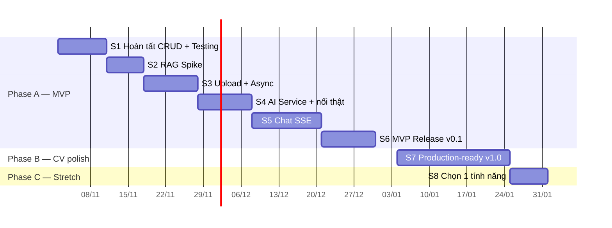

# 🧭 Smart Doc Assistant — Implementation Plan v4 (Personalized)

> **Ngày tạo**: 2026-11-01 · **Thay thế**: `2026-10-24-implementation-plan-v3.md` (giữ lại làm lịch sử) · **Người thực thi**: mentee tự tay code từng dòng.

> ⚠️ **QUY TẮC VÀNG (theo `CLAUDE.md`)**: Plan KHÔNG chứa source code. Mỗi task chỉ có: **mục tiêu → tư duy → 🔑 từ khóa → 🧠 câu hỏi phản biện → ✅ DoD**. AI là planner / reviewer / người ra đề — không viết code hộ.

**Goal:** MVP "kho tài liệu cá nhân có AI": upload PDF/TXT → embedding vào Qdrant → chat streaming có trích dẫn trang. Đây là **project 1/3** trong portfolio xin intern Backend (Axon, MoMo, Big Tech) năm 3.

**Architecture:** Java Spring Boot (:8080) giữ metadata (PostgreSQL), file gốc (disk), orchestrate. Python FastAPI (:8000) làm RAG (parse → chunk → embed → Qdrant → Gemini). Giao tiếp HTTP.

**Tech Stack:** Java 25 · Spring Boot 4.1.1 · PostgreSQL 18 · Qdrant v1.19.1 · Python FastAPI · `google-genai` · Gemini (chat + `gemini-embedding-001` — **kiểm tra lại tên model hiện hành lúc bắt đầu S2**).

---

## 0. Vì sao có v4 — thay đổi so với v3

v3 là plan "chung chung". v4 sửa theo **những gì Sprint 1 thực sự cho thấy về em**:

| Quan sát ở Sprint 1 | Thay đổi trong v4 |
|---|---|
| Test do AI sinh, em chưa học test | Thêm **S1-4 Testing Bootcamp** riêng; từ S1-3 trở đi **test-first** là bắt buộc, AI không viết test |
| Copy `equals` sang 4 entity mà không sửa cast → crash runtime; coi "compile được" là xong | Rule **"Compile ≠ Done"** + checklist copy-paste (mục 1) |
| Quiz ownership lần đầu: nhiều câu "không biết", lần 2 trả lời tốt | **Ownership Gate** cuối mỗi sprint — qua mới sang sprint sau |
| Em thích giữ đà ("move on") | Nợ kỹ thuật không bị bỏ — được **xếp lịch** vào task cụ thể (S1-5), không chặn flow |
| Câu trả lời 🧠 viết vào commit message → khó tra lại | Gom vào `docs/learning-log.md` — sau này chính là tài liệu ôn phỏng vấn |
| v3 có 8 sprint, không có mốc thời gian, không có "điểm dừng" | Có **timeline**, **MVP cut** rõ ràng và **Exit Criteria** để chuyển sang project 2 |
| RAG Spike nằm sau Upload | **Spike đưa lên trước Upload** — contract Java↔Python thiết kế từ dữ liệu thật, không đoán |
| Thiếu các chủ đề interviewer backend hay đào | Thêm: race condition / optimistic locking, side-effect sau commit, observability, Docker full-stack, CI, số liệu đo được |
| Web UI React có thể nuốt 1–2 tuần | UI **timebox 4 ngày**, chỉ đủ demo |

---

## 1. Luật làm việc cá nhân (đọc kỹ — áp dụng mọi task)

1. **Test-first (từ S1-3):** viết test **đỏ** trước → code cho **xanh** → refactor. Test do chính em gõ. AI chỉ được review test.
2. **Compile ≠ Done:** task chỉ xong khi có **test chứng minh hành vi** + chạy đủ lệnh trong ✅ DoD.
3. **Checklist copy-paste:** khi nhân một đoạn code ra N file → đọc lại từng dòng ở từng file; `grep` tên class gốc trong các file đích để bắt chỗ quên sửa (đúng lỗi `(Document) o` lần trước).
4. **Thang gợi ý khi bí (> 45 phút):** xin mentor theo cấp — *Hint 1*: từ khóa/tài liệu → *Hint 2*: pseudocode/sơ đồ → *Hint 3*: chỉ ra dòng sai. Không có Hint 4 = code.
5. **Learning log:** mọi câu 🧠 trả lời ngắn (3–5 dòng, bằng lời của em) vào `docs/learning-log.md`, theo sprint. Mentor chấm từ file này.
6. **Git flow kiểu công ty:** 1 sprint = 1 branch `feature/<tên>` = 1 PR vào `main`. Commit nhỏ, conventional commits. PR description: *What / Why / How tested*. Trước khi xin review: tự đọc diff 1 lượt.
7. **🚪 Ownership Gate (cuối mỗi sprint):** nhắn mentor `ownership check S<n>` → 5–7 câu hỏi về chính code của em, trả lời **không mở code**. Đạt ≥ 5/7 → merge PR, sang sprint mới. Chưa đạt → 1 buổi vá lỗ hổng rồi hỏi lại. Lỗ hổng được ghi vào learning log.

---

## 2. Global Constraints (kế thừa v3, rút gọn)

- Layered chặt: `controllers/` → `services/` (`@Transactional` chỉ ở đây) → `repositories/`. Entity không ra khỏi service — luôn qua DTO/record + MapStruct.
- REST: 200 / 201 + `Location` / 202 / 204 / 400 / 404 / 409 đúng chỗ; lỗi qua `@RestControllerAdvice` + `ProblemDetail`; cấm `catch (Exception e)` lỏng.
- Không lộ `filePath`/`storagePath`, cờ hệ thống, ID nội bộ không cần thiết.
- Upload ≤ **20MB**, chỉ PDF + TXT. Cổng bind `127.0.0.1`: Java 8080 · Python 8000 · Postgres 5432 · Qdrant 6333/6334.
- Schema chỉ do **Flyway**; `ddl-auto: validate`. API key chỉ ở env / `.env` (gitignored).

### Rủi ro phải có test ở task chủ nhà

| # | Rủi ro | Ứng xử đúng | Task |
|---|---|---|---|
| R1 | File 0 byte / `.pdf` giả | 400 rõ ràng | S3-2 |
| R2 | Ingest crash → kẹt `PROCESSING` mãi | Async bắt mọi lỗi → `ERROR`; watchdog dọn | S3-3, S7-2 |
| R3 | Filename chứa `../` | Lưu file bằng UUID, tên gốc chỉ là metadata | S3-2 |
| R4 | List kéo theo `chunks` (N+1, tràn RAM) | DTO list không có chunks | S1-2 ✅ |
| R5 | Client ngắt SSE giữa chừng | Hủy call sang Python, không leak connection | S5-3 |
| **R6** *(mới)* | DELETE chạy trong lúc async ingest đang cập nhật status | Không "hồi sinh" record đã xóa; không lost update | S1-3, S3-3 |

---

## 3. Hiện trạng (chốt 2026-11-01)

**Xong ✅:** S0 (Flyway V1, `validate`, entity chuẩn naming, env config, README) · S1-1 (GET detail + ProblemDetail 404/400) · S1-2 (list + Specification filter + pagination) · fix `equals/hashCode` proxy-safe cho 5 entity (chưa commit).

**Nợ kỹ thuật đã ghi — xếp lịch ở S1-5:**
- `Hibernate.getClass` → cân nhắc `getClassLazy`; gom vào `BaseEntity` (`@MappedSuperclass`).
- Chưa có test cho entity equality.
- `?sort=` chưa có allowlist (sort theo field lạ → 500); chưa giới hạn `max-page-size`.
- Serialize thẳng `PageImpl` (đã thấy warning trong log) → `PagedModel` / `VIA_DTO`.
- `DocumentControllerTest` do AI viết, dùng `any()` quá lỏng; import thừa trong controller.
- `docker-compose.yml`: thay đổi chưa commit đổi volume sang `/var/lib/postgresql/data` — **với image Postgres 18 khả năng cao là sai** (PG18 đổi layout PGDATA). Phải tự kiểm chứng.

**Chưa bắt đầu ⬜:** `ai-service/` (mới có thư mục rỗng), `frontend/` (thư mục rỗng), Testcontainers, CI.

---

## 4. Lộ trình & timeline

> **Giả định:** ~15 giờ/tuần, 1 "ngày" trong plan = ~4 giờ tập trung. Trùng lịch thi → **đẩy cả lịch sang phải, không cắt DoD test**.

| Mốc | Ngày mục tiêu | Ý nghĩa |
|---|---|---|
| 🏁 MVP v0.1 | **2026-12-31** | Upload → chat streaming có trích dẫn, chạy bằng 1 lệnh `docker compose` |
| 🏆 v1.0 | **2027-01-24** | Bản đưa vào CV: resilience, observability, CI, ADR, số liệu đo |
| ➡️ Project 2 | trước Tết (06/02/2027) | Dừng project 1 dù còn ý tưởng — ý tưởng thừa vào Backlog |

---

# Phase A — MVP

## Sprint 1 (phần còn lại) — DELETE, Testing Bootcamp, trả nợ · 2026-11-02 → 11-10

### S1-3: DELETE document (UC-07, chưa có vector) — *test-first*

**Tư duy:**
- Contract: `DELETE /api/v1/documents/{id}` → 204 body rỗng; không tồn tại → 404.
- Xóa gồm 3 thứ: DB record, file disk (S3 mới có), vectors (S4 mới có). Bây giờ: chỉ khai báo **interface** cho 2 bước ngoài DB, implementation sau.
- `@Transactional` bảo vệ được gì, **không** bảo vệ được gì? File disk / HTTP call **không** rollback được. Nên làm side-effect ngoài DB **trước** hay **sau khi commit**? Tìm hiểu cơ chế "chạy sau commit".
- Document đang `PROCESSING`: cho xóa hay trả **409 Conflict**? Chọn, ghi lý do vào learning log, có test cho quyết định đó.
- **R6:** nếu xóa thành công trong khi luồng async sau đó `save()` lại document → chuyện gì xảy ra? (Chỉ cần hiểu bây giờ, xử lý thật ở S3-3.)

**🔑** `@Transactional` boundaries · `TransactionSynchronization#afterCommit` · `@TransactionalEventListener(phase = AFTER_COMMIT)` · `deleteById` vs `delete` vs `existsById` · `409 Conflict` · RFC 9110 "idempotent methods"

**🧠** (1) DELETE là idempotent — vậy request thứ 2 trả 404 có vi phạm idempotency không? (2) 2 DELETE cùng id cùng lúc: mỗi bên nhận gì, DB ép điều gì? (3) Xóa DB thành công, xóa file fail → hệ thống còn nhất quán không, ai dọn rác?

**✅ DoD:**
- [ ] Test viết **trước** code: 204 + record biến mất; 404 khi không tồn tại; hành vi khi `PROCESSING`.
- [ ] Không có logic nghiệp vụ trong controller.

**Commit:** `feat: delete document with transactional service`

### S1-4: Testing Bootcamp — học test bằng chính code của em (2 ngày)

**Mục tiêu:** sau task này em tự viết được 3 loại test mà interviewer hay hỏi: unit, slice (web), integration (DB thật).

**Tư duy — 4 bài tập theo thứ tự:**
1. **Unit test service** (không Spring): mock repository + mapper, test `findById` (có / không có) và `findAllByStatusAndType`. Học: Arrange–Act–Assert, mock vs stub, `verify`.
2. **Viết lại `DocumentControllerTest` bằng tay** — đóng file cũ, viết từ đầu, rồi mới so sánh. Thay `any()` bằng matcher chính xác hoặc `ArgumentCaptor` để kiểm tra `Pageable` (page, size, sort) thực sự được truyền đúng.
3. **Integration test với Testcontainers** (Postgres thật): `DocumentSpec` lọc đúng với dữ liệu seed; Flyway chạy migration trong container.
4. **Test entity equality:** đưa entity mới (id null) vào `HashSet` → persist → vẫn tìm thấy; entity vs proxy (`getReferenceById`) cùng id → bằng nhau. Test này là **lưới an toàn** cho refactor `BaseEntity` ở S1-5.

**🔑** JUnit 5 · AssertJ · `@ExtendWith(MockitoExtension.class)` · `@Mock` / `@InjectMocks` · `ArgumentCaptor` · `@WebMvcTest` + `@MockitoBean` · `@DataJpaTest` + `@AutoConfigureTestDatabase(replace = NONE)` · Testcontainers + `@ServiceConnection` (Spring Boot 4 + Testcontainers 2.x — tên artifact đã đổi, đọc docs mới) · test pyramid

**🧠** (1) Vì sao không dùng H2 cho integration test của project này? (2) Unit test service dùng mock repository thì **không** bắt được loại bug nào? (3) `@WebMvcTest` load những bean nào, không load bean nào?

**✅ DoD:**
- [ ] `./mvnw test` xanh, có đủ 4 nhóm test trên, **toàn bộ do em gõ**.
- [ ] Cố ý làm hỏng code (vd bỏ filter status) → ít nhất 1 test đỏ. Hoàn tác.

**Commit:** `test: unit, web-slice and testcontainers tests for document module`

### S1-5: Trả nợ kỹ thuật + CI (1–1.5 ngày)

**Tư duy (mỗi gạch đầu dòng = 1 commit nhỏ):**
- **Docker PG18:** đọc trang image `postgres` trên Docker Hub (mục về PGDATA của bản 18+), xem log container, quyết định giữ hay revert thay đổi volume. Ghi kết luận vào learning log.
- **Refactor `BaseEntity`** *khi đã có test S1-4 bảo vệ*: gom `id`, audit fields, `equals/hashCode`; quyết định `getClass` vs `getClassLazy` dựa trên `open-in-view: false`. Chạy lại test → xanh = refactor an toàn. Flyway **không** cần migration mới — vì sao?
- **Pagination an toàn:** allowlist field cho `sort`, `max-page-size`; sort field lạ → 400 (không phải 500).
- **`PagedModel`:** hết warning serialize `PageImpl`; cập nhật test theo JSON shape mới.
- Dọn import thừa.
- **CI GitHub Actions:** chạy `./mvnw verify` mỗi push/PR (runner Ubuntu có sẵn Docker → Testcontainers chạy được).

**🔑** `@MappedSuperclass` · `Hibernate.getClassLazy` · `spring.data.web.pageable.max-page-size` · `PropertyReferenceException` · `@EnableSpringDataWebSupport(pageSerializationMode = VIA_DTO)` · GitHub Actions `setup-java` + cache Maven

**🧠** Vì sao làm refactor **sau** khi có test mà không làm trước?

**✅ DoD:** CI badge xanh trên README · `?sort=hacker` → 400 · không còn warning `PageImpl` trong log test.

**🚪 Ownership Gate S1** → merge `feature/document-management` vào `main`.

---

## Sprint 2 — RAG Spike: hiểu RAG bằng tay · 2026-11-11 → 11-17

**Mục tiêu:** 1 script Python chạy terminal: PDF thật → Qdrant → hỏi đáp có trích dẫn trang. Không FastAPI. Code bẩn được — giá trị là **hiểu** và **ra quyết định contract**.

**Files:** `ai-service/spike/spike_rag.py`, `ai-service/spike/requirements.txt`, `ai-service/spike/NOTES.md`, `.env` (gitignored).

**Tư duy (mỗi bước 1 hàm):**
1. venv + cài `pypdf`, `qdrant-client`, `google-genai`, `python-dotenv`.
2. Đọc PDF **từng trang** → cặp `(page, text)`.
3. Chunker: kích thước + overlap, mỗi chunk nhớ `{page, doc_name, chunk_index}`. Đếm token kiểu gì với model Google?
4. Embed batch — đọc docs: dimension mặc định, `output_dimensionality`, task type (document vs query).
5. Collection Qdrant (cosine) + upsert payload `{document_id, page, text}`.
6. Query: embed câu hỏi → top-k → prompt grounded ("chỉ trả lời từ context, thiếu thì nói không biết") → in câu trả lời + list `(doc, page)`.
7. Thí nghiệm, ghi `NOTES.md`: k=3 vs 8 · chunk nhỏ vs lớn · có/không overlap · ngưỡng score "không liên quan".

**Đầu ra quan trọng nhất — 3 quyết định contract (ghi trong `NOTES.md`):**
- Python trả gì cho Java sau ingest? Chỉ `chunkCount`, hay metadata từng chunk?
- **Bảng `document_chunk` trong Postgres có còn cần không** khi Qdrant payload đã giữ page + text? Đâu là source of truth? (Giữ, bỏ, hay thu gọn — em quyết, có lý do.)
- Python đọc file bằng **đường dẫn chung** hay Java **gửi bytes**? Ảnh hưởng gì khi chạy Docker ở S6?

**🔑** `pypdf` page extraction · chunking overlap · `qdrant-client` upsert / filter · `google-genai embed_content` · `gemini-embedding-001` dimensions · grounded prompt

**🧠** Vì sao cosine? Vector câu hỏi và chunk sinh từ 2 model khác nhau thì sao? Vì sao chunk phải giữ số trang?

**✅ DoD:** 3 câu hỏi trên 1 slide môn học thật (có trong tài liệu / không có / cần ghép 2 đoạn) trả lời đúng + đúng trang · `NOTES.md` có thí nghiệm + 3 quyết định.

**Commit:** `feat(spike): standalone RAG proof-of-concept with experiment notes` · **🚪 Gate S2**

---

## Sprint 3 — Upload + pipeline async (Java, AI còn là stub) · 2026-11-18 → 11-27 · UC-01, UC-02

### S3-1: Contract Java → AI Service + Storage

**Tư duy:**
- Interface `AiServiceClient` với contract **lấy từ quyết định S2** (không đoán). Stub luôn thành công, bật bằng `@Profile("stub")`.
- Interface `FileStorage` (save / delete / resolve) — implementation local disk. S1-3 DELETE giờ cắm được bước xóa file.
- Migration Flyway mới nếu S2 quyết định đổi `document_chunk`.

**🔑** `@HttpExchange` / HTTP Interface clients (Spring 7) · `@Profile` · ports & adapters

**Commit:** `feat: ai service client contract and file storage abstraction`

### S3-2: `POST /api/v1/documents` — multipart upload

**Tư duy:**
- `multipart/form-data` (`file`, `title` optional) → **202 Accepted** + `Location` + body `status=PROCESSING`.
- Validate **trước khi** chạm disk: không rỗng, ≤ 20MB, extension + MIME whitelist, **magic bytes** (R1).
- Tên file trên disk = UUID; `getOriginalFilename()` chỉ là metadata (R3).
- Upload quá limit thì exception nào ném ra **trước** controller? Map nó sang 400/413 trong handler.

**🔑** `MultipartFile` · `spring.servlet.multipart.*` · `MaxUploadSizeExceededException` · magic bytes · `Path.normalize` · `413 Content Too Large`

**🧠** File `.txt` 1GB đổi đuôi `.pdf` bị chặn ở lớp nào? 202 hay 201 — tranh luận cả 2 phía.

**✅ DoD:** Test: hợp lệ → 202 + record `PROCESSING` + file tồn tại · rỗng → 400 · quá lớn → 400/413 · `.pdf` giả → 400 · JSON không có `filePath`.

**Commit:** `feat: multipart upload with validation (size, type, magic bytes)`

### S3-3: Pipeline async PROCESSING → READY / ERROR (+ R6)

**Tư duy:**
- Commit DB `PROCESSING` → trả 202 → nền gọi `AiServiceClient.ingest` → `READY` + `chunkCount` / `ERROR` + `errorMessage` (R2: exception trong `@Async void` **không** về caller).
- Chỉ bắt đầu async **sau khi** transaction upload commit — nếu không, thread nền có thể chưa thấy record.
- Executor riêng có tên, giới hạn pool + queue. Bẫy self-invocation của `@Async`/`@Transactional`.
- **R6:** update status trong thread nền phải không ghi đè document đã bị xóa / không lost update. Chọn 1: `@Version` (optimistic locking) hoặc conditional update (`... WHERE status = PROCESSING`). So sánh 2 cách trong learning log.

**🔑** `@EnableAsync` · `ThreadPoolTaskExecutor` · `@TransactionalEventListener` · `@Version` / `OptimisticLockException` · `@Modifying` query · Awaitility

**🧠** App restart khi doc đang `PROCESSING` → số phận? (ghi nhận, xử lý ở S7-2)

**✅ DoD:** Test: upload → cuối cùng `READY`; stub ném lỗi → `ERROR` + message; stub chậm 3s mà upload vẫn trả < 1s; xóa trong lúc đang xử lý → document **không** sống lại.

**Commit:** `feat: async ingest pipeline with safe status transitions`

### S3-4 *(tùy chọn, nếu dư thời gian)*: UC-04 Add Note — tái dùng pipeline, 201, validate độ dài.

**🚪 Gate S3**

---

## Sprint 4 — AI Service FastAPI + nối thật · 2026-11-28 → 12-07

### S4-1: Khung FastAPI + `/health` + `/ingest` idempotent

**Tư duy:** module hóa `routers/` · `services/` (parser, chunker, embedder, vector_store, llm) · `config.py` (env). Pydantic model khớp **từng chữ** với contract Java. Ingest lại cùng `documentId` → xóa points cũ theo filter rồi upsert (idempotent). Collection + dimension là config tập trung.

**🔑** `APIRouter` · Pydantic v2 · pydantic-settings · qdrant delete by filter · pytest

**✅ DoD:** `/health` OK · ingest PDF thật → thấy points trên dashboard · ingest 2 lần → không nhân đôi · **pytest cho chunker** (hàm thuần, dễ test nhất).

**Commit:** `feat(ai-service): fastapi skeleton with idempotent ingest`

### S4-2: Java nối Python thật

**Tư duy:** implementation thật của `AiServiceClient`; timeout connect/read là **config**, không hard-code; profile mặc định = thật, `stub` khi Python không chạy.

**🧠** `/ingest` trả 200 khi xử lý xong hay khi nhận request? Điều này quyết định read timeout bao nhiêu.

**✅ DoD:** Swagger upload PDF → `READY`, `chunkCount > 0` · tắt Python → `ERROR` message rõ (R2).

**Commit:** `feat: wire backend to real ai-service ingest`

### S4-3: DELETE trọn vẹn (DB + disk + vector)

**Tư duy:** Python expose xóa vectors theo `documentId` (em chọn verb + path). Thứ tự xóa nào an toàn nhất khi 1 bước fail? Bước fail thì log + để watchdog/retry dọn, hay báo lỗi cho client?

**✅ DoD:** upload → delete → không còn points, file, record.

**Commit:** `feat: full document deletion across db, disk, and vector store` · **🚪 Gate S4**

---

## Sprint 5 — Chat + SSE streaming · 2026-12-08 → 12-20 · UC-08, UC-09, UC-10

### S5-1: Python `POST /chat` SSE

**Tư duy:** request `{query, documentIds[], history[]}`; search **chỉ trong** `documentIds`; event token + event cuối `sources` `{docName, page, snippet, score}`; context rỗng / score thấp → câu "không tìm thấy trong tài liệu" (UC-09). Sources = kết quả search đã dùng, không search lần 2.

**🔑** `StreamingResponse` · `text/event-stream` · Gemini streaming · qdrant payload filter

**✅ DoD:** `curl -N` thấy token chảy dần + event sources đúng trang. **Commit:** `feat(ai-service): sse chat endpoint with citations`

### S5-2: Conversation endpoints (Java)

**Tư duy:** `POST /api/v1/conversations` (title + `documentIds[]`) → 201 + Location; doc phải `READY`, không thì 400; `GET` list; `GET /{id}/messages` phân trang theo thời gian. Lịch sử gửi sang Python chỉ lấy **N tin gần nhất** — vì sao?

**🧠** Load conversation kèm documents + messages — chỗ nào dễ dính N+1? Kiểm chứng bằng `show-sql`.

**✅ DoD:** test CRUD + rule `READY` (test-first). **Commit:** `feat: conversation endpoints with ready-documents validation`

### S5-3: Java proxy SSE + lưu lịch sử

**Tư duy:** `POST /api/v1/conversations/{id}/messages` → `text/event-stream`; nhận stream từ Python và forward. USER message lưu ngay; ASSISTANT lưu khi stream xong (gộp token + sources). Client disconnect giữa chừng → lưu hay không (R5)? Hủy call Python thế nào? Timeout stream config riêng, khác ingest.

**🔑** `SseEmitter` vs WebClient `Flux<ServerSentEvent>` (so sánh, viết 3 dòng kết luận) · async request timeout · cancellation

**🧠** Vì sao không cho client gọi thẳng Python :8000? (≥ 2 lý do kiến trúc)

**✅ DoD:** curl qua :8080 thấy token chảy + sources · `chat_message` có USER + ASSISTANT (sources JSON) · câu ngoài tài liệu → AI nói không biết.

**Commit:** `feat: sse chat proxy with message persistence` · **🚪 Gate S5**

---

## Sprint 6 — MVP Release v0.1 · 2026-12-21 → 12-31

### S6-1: Web UI tối giản — **timebox 4 ngày**

Em là backend — UI chỉ cần đủ demo. Đề xuất: Vite + vanilla JS/TS (ít khái niệm mới); React chỉ khi em chủ động muốn học. Hết 4 ngày thì dừng ở mức hiện có.
- **Documents:** upload (validate 20MB/loại phía client), bảng status, polling ~3s khi có `PROCESSING`, Delete có confirm.
- **Chat:** chọn documents, stream bằng `fetch` + `ReadableStream` (vì sao không dùng được `EventSource` với POST?), render Markdown, khối "Nguồn".

### S6-2: Docker full-stack

Dockerfile multi-stage cho backend + Dockerfile cho ai-service; compose chạy **cả 4 service** bằng 1 lệnh; healthcheck + `depends_on: condition`; chia sẻ file theo quyết định S2.

**🔑** multi-stage build · non-root user · `depends_on.condition: service_healthy` · Spring Boot layered jar

### S6-3: README portfolio

Sơ đồ kiến trúc (Mermaid), chạy trong 3 lệnh, GIF demo 30s, mục "Design decisions" link sang ADR.

**✅ DoD Sprint 6 (Demo Day):** clone repo sạch trên máy khác (hoặc xóa hết volume) → `docker compose up` → upload PDF → READY → chat stream có trích dẫn. Tag **`v0.1.0`**. **🚪 Gate S6**

---

# Phase B — CV polish

## Sprint 7 — Production-ready v1.0 · 2027-01-04 → 01-24

Mỗi mục = 1 PR nhỏ:

1. **Resilience:** retry + backoff cho **ingest** (vì sao **không** retry chat stream?); circuit breaker khi Python chết liên tục. 🔑 Spring Framework 7 `@Retryable` (built-in) vs Resilience4j — kiểm tra compatibility Boot 4 trước khi chọn.
2. **Watchdog:** `@Scheduled` quét `PROCESSING` quá X phút → `ERROR` (R2 + orphaned state từ S3-3). Chạy 2 instance thì sao? (🔑 ShedLock)
3. **Observability:** Actuator health có kiểm tra ai-service; **correlation ID** sinh ở Java, truyền header sang Python, có trong log 2 bên (🔑 MDC, `OncePerRequestFilter`).
4. **Đo đạc — có số cho CV:** đo p95 của list endpoint và *time-to-first-token* của chat bằng k6 hoặc `hey`; ghi kết quả vào README.
5. **ADR:** 3–5 file `docs/adr/` (vd: 202 cho upload, source of truth của chunks, optimistic locking vs conditional update, SSE vs WebSocket, chuyển file bằng path vs bytes).
6. **Mock interview** với mentor: 45 phút "kể về project + system design deep-dive".

**✅ DoD:** CI xanh · tag **`v1.0.0`** · CV có 3 bullet mỗi bullet có 1 con số hoặc 1 quyết định kỹ thuật.

---

# Phase C — Stretch (chọn **tối đa 1**, timebox 1 tuần)

- **A. Content generation** (UC-11/12): summary + quiz với Gemini structured output (JSON schema / Pydantic), lưu `generated_content`. *Đề xuất* — đây là điểm khác biệt chính của sản phẩm.
- **B. Add URL** (UC-03) + **SSRF guard** (chỉ http/https, chặn IP private) — rất hợp để kể chuyện security.

Còn lại (Research Agent, Search & Tags, Telegram, multi-user, OCR) → **Backlog, không làm trong project 1**.

---

## 5. Exit Criteria — khi nào project 1 "xong" để sang project 2

- [ ] `v1.0.0` tag, CI xanh, chạy được bằng 1 lệnh từ repo sạch.
- [ ] Test do em viết: unit + web slice + Testcontainers ở Java; pytest ở Python.
- [ ] README có kiến trúc, demo GIF, số liệu đo, link ADR.
- [ ] Learning log đầy đủ các sprint; qua toàn bộ Ownership Gate.
- [ ] Trả lời trôi chảy (không nhìn code) các câu dưới đây.

### Câu hỏi phỏng vấn project này phải giúp em trả lời

1. Đi từ lúc user bấm upload tới lúc `READY` — từng bước, từng thread, từng transaction.
2. Vì sao 202? Client biết khi nào xong bằng cách nào?
3. Python chết giữa chừng thì sao? App Java restart thì sao?
4. 2 request cùng sửa/xóa 1 document — em chống race thế nào?
5. Vì sao Postgres **và** Qdrant? Source of truth là ai?
6. RAG là gì, chunking ảnh hưởng chất lượng câu trả lời ra sao — em đã đo gì?
7. SSE vs WebSocket vs polling — vì sao chọn SSE?
8. Em test hệ thống thế nào? Vì sao Testcontainers thay vì H2?
9. Nếu lượng user tăng 100 lần, chỗ nào vỡ trước?
10. Nếu làm lại từ đầu, em đổi gì?

---

## 6. Kỹ năng CV theo sprint

| Sprint | Chứng minh được |
|---|---|
| S1 | REST semantics, RFC 9457, JPA Specification, pagination an toàn, test pyramid, Testcontainers, CI |
| S2 | RAG từ gốc: embedding, vector search, chunking — có thí nghiệm |
| S3 | Multipart security (magic bytes, path traversal), async processing, optimistic locking, side-effect sau commit |
| S4 | Service-to-service contract, idempotency, timeout, profile-based stub |
| S5 | SSE streaming, cancellation, persistence song song stream |
| S6 | Docker multi-stage, full-stack compose, documentation |
| S7 | Resilience, observability, đo hiệu năng, ADR |

> **Interview story:** "Em build một NotebookLM mini: 2 service, 2 database, RAG streaming có trích dẫn. Đây là thí nghiệm chunking em tự chạy, đây là cách em chống race condition khi xóa tài liệu đang xử lý, và đây là p95 em đo được."
