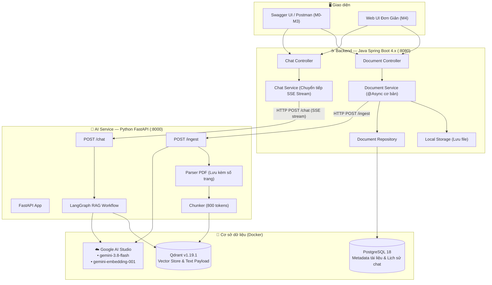
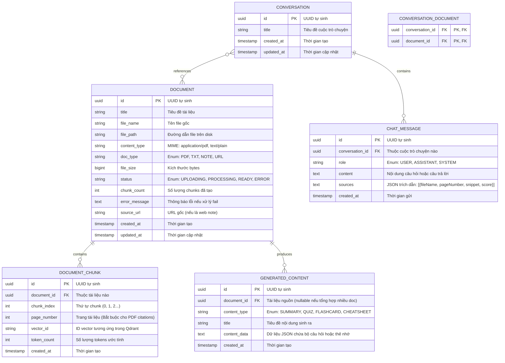

# 📋 Smart Doc Assistant — Pragmatic Implementation Plan (v2.2)

> **Triết lý phát triển**: **"Make it work first, make it robust later"**  
> 1. **Giai đoạn 1 (M0 → M4)**: Tập trung làm luồng chạy bình thường (Happy Path) đơn giản, dễ hiểu, ra sản phẩm chạy được nhanh nhất.  
> 2. **Giai đoạn 2 (M5 → M6)**: Bổ sung tính năng nâng cao và nâng cấp lên chuẩn Production-Ready (Timeout, Retry, Circuit Breaker, Idempotency).

---

## 📖 Mục lục

1. [Phase 0 — Scope & Requirements (Đơn giản hóa cho MVP)](#phase-0--scope--requirements-đơn-giản-hóa-cho-mvp)
2. [Phase 1 — System Architecture (Happy Path)](#phase-1--system-architecture-happy-path)
3. [Phase 2 — Database Design (ERD MVP)](#phase-2--database-design-erd-mvp)
4. [Phase 3 — API Contracts (Đơn giản hóa)](#phase-3--api-contracts-đơn-giản-hóa)
5. [Phase 4 — Lộ Trình Triển Khai (M0 → M6)](#phase-4--lộ-trình-triển-khai-m0--m6)
6. [Phase 5 — Nâng Cấp Production-Ready (Làm ở M6)](#phase-5--nâng-cấp-production-ready-làm-ở-m6)
7. [Phase 6 — Docker Configuration](#phase-6--docker-configuration)

---

# Phase 0 — Scope & Requirements (Đơn giản hóa cho MVP)

* **Mục tiêu cốt lõi**: Upload được file PDF/TXT → AI lưu vào Qdrant → Chat hỏi đáp có streaming và trích dẫn số trang.
* **Tạm gác lại ở MVP ban đầu**:
  * Chưa cần cài đặt cấu hình phức tạp của Resilience4j (Circuit Breaker, Retry policy nâng cao).
  * Chưa cần xử lý đa luồng phân tán phức tạp hay Watchdog.
  * Chỉ cần gọi HTTP thông thường giữa Java và Python với timeout cơ bản.

---

# Phase 1 — System Architecture (Happy Path)



---

# Phase 2 — Database Design (ERD & Entity Specifications)



### 2.1 Đặc Tả Chi Tiết 5 Entities Trong Hệ Thống

#### 1. Entity `Document` (Bảng `document`)
* **Package**: `com.smartdoc.api.modules.document.entities`
* **Mục đích**: Lưu trữ thông tin tài liệu đã tải lên, đường dẫn file vật lý và trạng thái nhúng vector.
* **Các trường dữ liệu**:
  * `id`: `UUID` (PK, tự sinh)
  * `title`: `String` (Tiêu đề hiển thị)
  * `fileName`: `String` (Tên file gốc, nullable = false)
  * `filePath`: `String` (Đường dẫn lưu trên disk, nullable = false)
  * `contentType`: `String` (MIME type, ví dụ: `application/pdf`)
  * `fileSize`: `Long` (Kích thước byte)
  * `status`: `DocumentStatus` (`@Enumerated(EnumType.STRING)`, nullable = false)
  * `docType`: `DocumentType` (`@Enumerated(EnumType.STRING)`: `PDF`, `TXT`, `NOTE`, `URL`)
  * `chunkCount`: `int` (Số lượng chunk sau khi cắt)
  * `errorMessage`: `String` (`columnDefinition = "TEXT"`)
  * `createdAt`, `updatedAt`: `LocalDateTime` (Audit timestamps)
* **Quan hệ JPA**:
  * `@OneToMany(mappedBy = "document", cascade = CascadeType.ALL, orphanRemoval = true)` tới `List<DocumentChunk> chunks`
  * `@ManyToMany(mappedBy = "documents")` tới `Set<Conversation> conversations`

---

#### 2. Entity `DocumentChunk` (Bảng `document_chunk`)
* **Package**: `com.smartdoc.api.modules.document.entities`
* **Mục đích**: Theo dõi vết từng mảnh văn bản (chunk) đã cắt từ document, lưu số trang để trích dẫn (citation) và vector_id tương ứng trong Qdrant.
* **Các trường dữ liệu**:
  * `id`: `UUID` (PK, tự sinh)
  * `chunkIndex`: `int` (Thứ tự từ 0 đến N)
  * `pageNumber`: `int` (Số trang trong file PDF gốc, cực kỳ quan trọng cho citation)
  * `vectorId`: `String` (UUID của point lưu trong Qdrant)
  * `tokenCount`: `int` (Số token của chunk)
  * `createdAt`: `LocalDateTime` (`@CreationTimestamp`)
* **Quan hệ JPA**:
  * `@ManyToOne(fetch = FetchType.LAZY)` tới `Document document` (`@JoinColumn(name = "document_id", nullable = false)`)

---

#### 3. Entity `Conversation` (Bảng `conversation`)
* **Package**: `com.smartdoc.api.modules.conversation.entities`
* **Mục đích**: Đại diện cho một phiên chat hỏi đáp (tương tự 1 đoạn chat trên ChatGPT/NotebookLM).
* **Các trường dữ liệu**:
  * `id`: `UUID` (PK, tự sinh)
  * `title`: `String` (Tiêu đề cuộc trò chuyện, ví dụ: "Hỏi về Design Patterns")
  * `createdAt`, `updatedAt`: `LocalDateTime`
* **Quan hệ JPA**:
  * `@ManyToMany` tới `Set<Document> documents`: Bảng phụ `conversation_documents` lưu danh sách các tài liệu được gán vào cuộc chat này để giới hạn phạm vi tìm kiếm vector.
  * `@OneToMany(mappedBy = "conversation", cascade = CascadeType.ALL, orphanRemoval = true)` tới `List<ChatMessage> messages` (Xếp theo thời gian tăng dần).

---

#### 4. Entity `ChatMessage` (Bảng `chat_message`)
* **Package**: `com.smartdoc.api.modules.conversation.entities`
* **Mục đích**: Lưu từng lượt tin nhắn (turn) của người dùng và câu trả lời của AI kèm danh sách nguồn trích dẫn.
* **Các trường dữ liệu**:
  * `id`: `UUID` (PK, tự sinh)
  * `role`: `MessageRole` (`@Enumerated(EnumType.STRING)`: `USER`, `ASSISTANT`, `SYSTEM`)
  * `content`: `String` (`columnDefinition = "TEXT"`, nullable = false)
  * `sources`: `String` (`columnDefinition = "TEXT"`, lưu JSON danh sách trích dẫn: tên file, số trang, đoạn văn bản trích dẫn, điểm tương đồng)
  * `createdAt`: `LocalDateTime` (`@CreationTimestamp`)
* **Quan hệ JPA**:
  * `@ManyToOne(fetch = FetchType.LAZY)` tới `Conversation conversation` (`@JoinColumn(name = "conversation_id", nullable = false)`)

---

#### 5. Entity `GeneratedContent` (Bảng `generated_content`)
* **Package**: `com.smartdoc.api.modules.content.entities`
* **Mục đích**: Lưu trữ nội dung AI tự động tạo ra từ tài liệu (Quiz trắc nghiệm, tóm tắt, flashcard).
* **Các trường dữ liệu**:
  * `id`: `UUID` (PK, tự sinh)
  * `title`: `String` (Tiêu đề, ví dụ: "Bộ Quiz 10 câu ôn tập Singleton Pattern")
  * `contentType`: `ContentType` (`@Enumerated(EnumType.STRING)`: `SUMMARY`, `QUIZ`, `FLASHCARD`, `CHEATSHEET`)
  * `contentData`: `String` (`columnDefinition = "TEXT"`, lưu cấu trúc JSON của bộ câu hỏi/thẻ nhớ để client render)
  * `createdAt`: `LocalDateTime` (`@CreationTimestamp`)
* **Quan hệ JPA**:
  * `@ManyToOne(fetch = FetchType.LAZY)` tới `Document document` (`@JoinColumn(name = "document_id", nullable = true)`)

---

### 2.2 Best Practice: Lớp `BaseEntity` (Dùng Chung)
Để không phải lặp lại các trường audit (`id`, `createdAt`, `updatedAt`) ở tất cả các entity, bạn có thể tạo một abstract class:
* **Package**: `com.smartdoc.api.common.entities.BaseEntity`
* Đánh dấu `@MappedSuperclass`
* Chứa `@Id`, `@CreationTimestamp`, `@UpdateTimestamp` để các Entity khác chỉ cần `extends BaseEntity`.

---

# Phase 3 — API Contracts (Đơn giản hóa)

### 3.1 Java Backend APIs
* `POST /api/v1/documents` (`multipart/form-data`):
  * Nhận file → Lưu disk → Tạo record DB `status = PROCESSING` → Trả `202 Accepted` ngay.
  * Method `@Async`: Gọi `POST http://localhost:8000/ingest`. Nếu thành công đổi `status = READY`, nếu lỗi đổi `status = ERROR`.
* `GET /api/v1/documents`: Lấy danh sách tài liệu (kèm phân trang).
* `DELETE /api/v1/documents/{id}`: Xóa file disk, xóa DB, gọi xóa Qdrant.
* `POST /api/v1/conversations/{id}/messages`: Nhận câu hỏi, gọi Python `/chat` và stream SSE về cho client.

### 3.2 Python AI Service APIs
* `POST /ingest`:
  * Body: `{ "documentId": "uuid", "filePath": "...", "contentType": "application/pdf" }`
  * Đọc PDF từng trang → Chia chunk → Tạo vector embedding → Lưu Qdrant.
* `POST /chat`:
  * Body: `{ "query": "...", "documentIds": [...], "chatHistory": [...] }`
  * Vector search Qdrant → Ghép prompt → Stream câu trả lời từ Gemini.

---

# Phase 4 — Lộ Trình Triển Khai (M0 → M6)

```
       M0: Setup Hạ Tầng (Docker Postgres, Qdrant + Skeleton 2 Project)
                                 │
                                 ▼
       M1: The Spike (1 Script Python đọc PDF → Qdrant → Gemini → Output)
                                 │
                                 ▼
       M2: Document Management (Upload PDF/TXT, lưu DB, gọi Python xử lý)
                                 │
                                 ▼
       M3: Chat & Streaming (SSE Stream từ Python qua Java tới Client)
                                 │
                                 ▼
       M4: Minimal Web UI (Web đơn giản để Upload & Chat)
                                 │
                                 ▼
       M5: Content Generation (Tạo Quiz JSON, Tóm tắt)
                                 │
                                 ▼
       M6: Production-Ready & Hardening (Timeout, Retry, Circuit Breaker...)
```

---

### 🟢 Milestone M0: Setup Hạ Tầng & Khung Dự Án (1 - 2 ngày)
* **Mục tiêu**: Bật được DB và chạy được 2 ứng dụng Java + Python ở mức cơ bản.
* **Công việc**:
  1. Chạy `docker compose up -d` (Postgres 18, Qdrant v1.19.1).
  2. Tạo project **Spring Boot 4.x** (Dependencies: Web, Data JPA, PostgreSQL Driver, Validation, Flyway).
  3. Tạo project **FastAPI** (`fastapi`, `uvicorn`, `qdrant-client`, `google-genai`).
  4. Test: Java gọi `GET http://localhost:8000/health` thành công.

---

### 🎯 Milestone M1: The Spike — Thử Nghiệm RAG Thuần Túy (2 - 3 ngày)
> [!IMPORTANT]
> Viết 1 script Python độc lập để kiểm chứng luồng RAG với file PDF môn học thật trước khi ghép nối hệ thống.

* **Công việc**:
  1. Viết script đọc 1 file PDF (trích xuất text và số trang `page`).
  2. Chia chunk (800 tokens) kèm metadata `{page: N}`.
  3. Tạo embedding với `gemini-embedding-001` → lưu vào Qdrant.
  4. Viết hàm query: lấy câu hỏi → search Qdrant → gửi context vào `gemini-3.8-flash` → in câu trả lời ra terminal kèm trích dẫn số trang.
* **Kết quả**: Bạn hiểu rõ 100% cách RAG hoạt động trong thực tế.

---

### 📦 Milestone M2: Quản Lý Tài Liệu (3 - 4 ngày)
* **Mục tiêu**: Xây dựng luồng upload tài liệu hoàn chỉnh phía Java.
* **Công việc**:
  1. Viết Entity `Document` và `DocumentRepository` (áp dụng kiến thức JPA đã học).
  2. `DocumentController`: Endpoint `POST /api/v1/documents` nhận file.
  3. `DocumentService`:
     - Lưu file vào thư mục `storage/`.
     - Lưu DB trạng thái `PROCESSING`.
     - Dùng `@Async` gọi sang Python `POST /ingest`.
     - Python xử lý xong trả về 200 → Java cập nhật DB thành `READY`.
  4. Endpoint `DELETE /api/v1/documents/{id}`: Xóa DB, xóa file.
* **Kết quả**: Dùng Swagger UI/Postman upload file PDF → thấy file được lưu, DB đổi sang `READY`, Qdrant có vector.

---

### 💬 Milestone M3: Chat Hỏi Đáp & Streaming SSE (3 - 4 ngày)
* **Mục tiêu**: Chat với AI có streaming từng chữ.
* **Công việc**:
  1. Python FastAPI: Endpoint `POST /chat` nhận câu hỏi, tìm vector trong Qdrant, stream token từ Gemini trả về qua Server-Sent Events (SSE).
  2. Java Spring Boot: Nhận SSE stream từ Python bằng `WebClient` và forward thẳng về cho client.
  3. Lưu lịch sử câu hỏi và câu trả lời vào bảng `chat_messages`.
* **Kết quả**: Dùng curl hoặc test tool thấy câu trả lời của AI nhảy ra từng chữ mượt mà.

---

### 🎨 Milestone M4: Giao Diện Web Đơn Giản (3 - 5 ngày)
* **Mục tiêu**: Không cần dùng Postman/Swagger nữa, thao tác trực tiếp trên trình duyệt.
* **Công việc**:
  1. Tạo giao diện web đơn giản (HTML/JS trong `src/main/resources/static` hoặc React Vite):
     - Khu vực kéo thả upload file PDF + xem danh sách tài liệu đã upload.
     - Khung chat hiển thị tin nhắn user và AI (streaming text + hiển thị tên file và số trang trích dẫn).
* **Kết quả**: Ứng dụng đã hoàn chỉnh luồng nghiệp vụ chính (MVP)!

---

### 📝 Milestone M5: Content Generation — Tạo Quiz & Tóm Tắt (3 - 4 ngày)
* **Mục tiêu**: Thêm tính năng học tập ôn thi.
* **Công việc**:
  1. Endpoint yêu cầu AI tóm tắt tài liệu đã chọn.
  2. Endpoint yêu cầu AI sinh 10 câu trắc nghiệm (Structured JSON) từ nội dung tài liệu.
  3. Lưu kết quả vào bảng `generated_content`.

---

### 🛡️ Milestone M6: Nâng Cấp Lên Chuẩn Production-Ready (Sau khi MVP đã chạy ổn)
* **Mục tiêu**: Nâng cấp hệ thống để chạy bền bỉ, không sợ rớt mạng hay sập service.
* **Công việc**:
  1. **Timeouts**: Cấu hình Connect Timeout 3s, Read Timeout 60s cho `WebClient`.
  2. **Retry & Backoff**: Dùng `@Retry` (Resilience4j) tự động thử lại 3 lần nếu Python service bận.
  3. **Circuit Breaker**: Tự động ngắt mạch nếu Python service bị sập liên tục.
  4. **Idempotency**: Tránh đúp vector khi retry ingest tài liệu.
  5. **Watchdog**: Job `@Scheduled` quét và đổi trạng thái các tài liệu bị kẹt ở `PROCESSING` quá lâu thành `ERROR`.
  6. **Security**: Chặn SSRF khi crawl URL, kiểm tra magic bytes của file upload.

---

# Phase 6 — Docker Configuration

File `docker/docker-compose.yml` giữ nguyên gọn gàng:

```yaml
services:
  postgres:
    image: postgres:18-alpine
    container_name: smartdoc_postgres
    restart: unless-stopped
    environment:
      - POSTGRES_DB=smartdoc
      - POSTGRES_USER=smartdoc
      - POSTGRES_PASSWORD=smartdoc_dev
    ports:
      - "127.0.0.1:5432:5432"
    volumes:
      - postgres_data:/var/lib/postgresql/data

  qdrant:
    image: qdrant/qdrant:v1.19.1
    container_name: smartdoc_qdrant
    restart: unless-stopped
    ports:
      - "127.0.0.1:6333:6333"
      - "127.0.0.1:6334:6334"
    volumes:
      - qdrant_data:/qdrant/storage

  postgres_data:
  qdrant_data:
```
