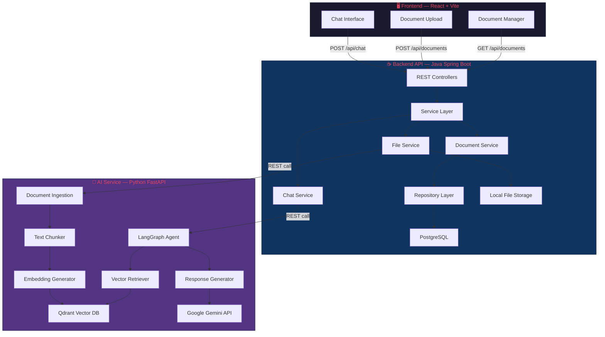
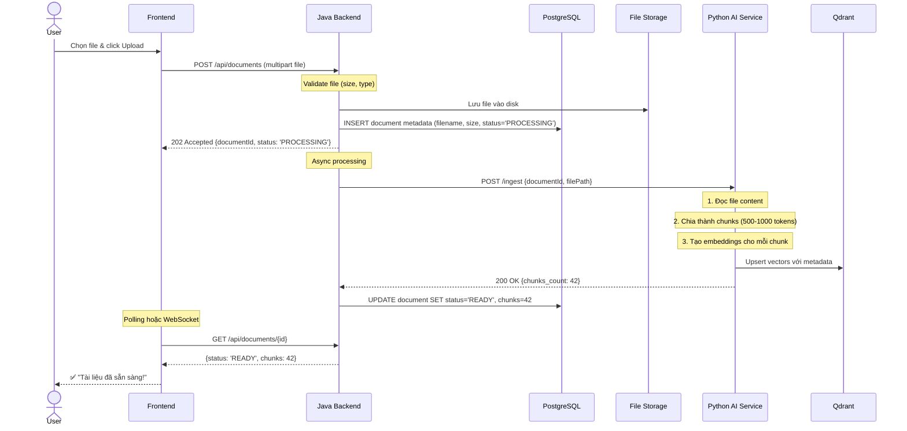
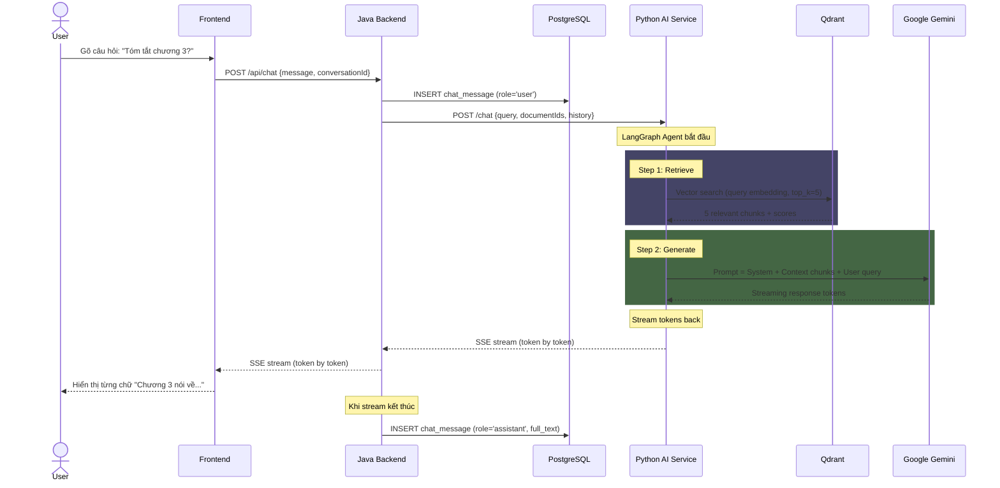
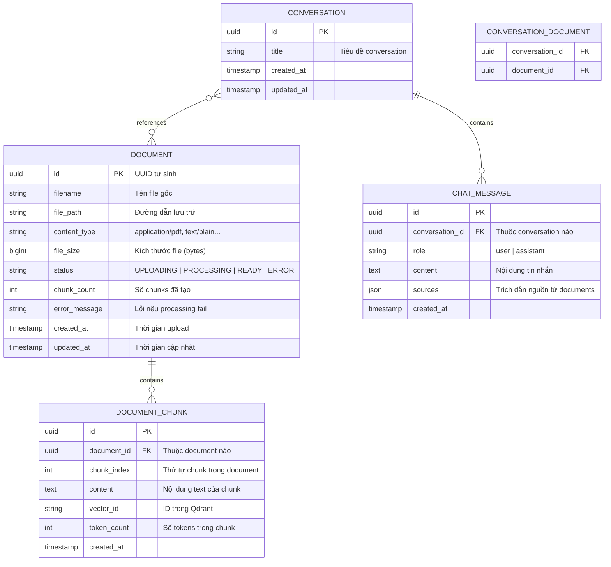
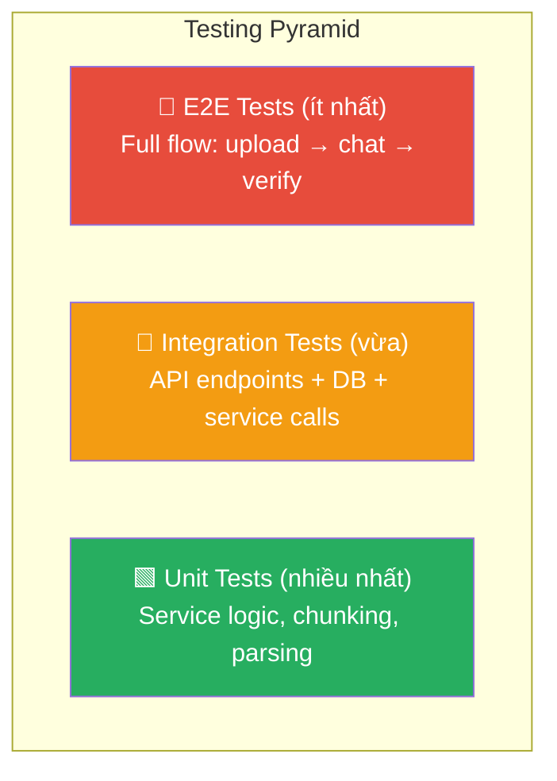
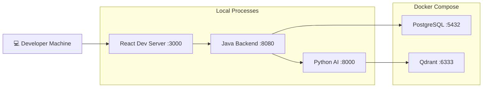

# 📋 Smart Doc Assistant — Production-Grade Implementation Plan

> **Mục đích**: Đây là cách một **Software Engineer chuyên nghiệp** lên kế hoạch cho 1 dự án thực tế. Mỗi phần mình sẽ giải thích **tại sao** họ làm như vậy.

---

## 📖 Mục lục

1. [Phase 0 — Requirements Gathering](#phase-0--requirements-gathering-thu-thập-yêu-cầu)
2. [Phase 1 — System Design](#phase-1--system-design-thiết-kế-hệ-thống)
3. [Phase 2 — Database Design](#phase-2--database-design-thiết-kế-cơ-sở-dữ-liệu)
4. [Phase 3 — API Design](#phase-3--api-design-thiết-kế-api)
5. [Phase 4 — Development Sprints](#phase-4--development-sprints-lộ-trình-phát-triển)
6. [Phase 5 — Testing Strategy](#phase-5--testing-strategy-chiến-lược-kiểm-thử)
7. [Phase 6 — DevOps & Deployment](#phase-6--devops--deployment)
8. [Glossary — Giải thích thuật ngữ](#glossary--giải-thích-thuật-ngữ)

---

# Phase 0 — Requirements Gathering (Thu thập yêu cầu)

> [!TIP]
> **Tại sao phải làm bước này?** SWE giỏi KHÔNG BAO GIỜ nhảy vào code ngay. Họ dành 20-30% thời gian để hiểu rõ bài toán. Code sai requirement thì vứt đi viết lại — tốn gấp 5 lần thời gian.

## 1.1 Tổng quan sản phẩm (Product Overview)

| Mục | Mô tả |
|-----|-------|
| **Tên sản phẩm** | Smart Doc Assistant |
| **Mô tả 1 dòng** | Trợ lý cá nhân AI giúp upload tài liệu, lưu trữ kiến thức, và trả lời câu hỏi dựa trên tài liệu đã upload |
| **Target User** | Cá nhân muốn quản lý & truy vấn kiến thức từ tài liệu |
| **Problem Solved** | Đọc nhiều tài liệu nhưng không nhớ hết, tìm kiếm thông tin mất thời gian |

## 1.2 User Stories (Câu chuyện người dùng)

> [!NOTE]
> **User Story** là cách SWE mô tả tính năng từ góc nhìn người dùng. Format: **"As a [ai], I want to [gì], so that [tại sao]"**. Mỗi story phải đủ nhỏ để code trong 1-3 ngày.

### 🟢 MVP (Minimum Viable Product) — Làm trước
| ID | User Story | Priority |
|----|-----------|----------|
| US-01 | Là user, tôi muốn **upload file PDF/TXT** lên hệ thống để lưu trữ tài liệu | P0 (Must) |
| US-02 | Là user, tôi muốn **xem danh sách tài liệu** đã upload để quản lý | P0 (Must) |
| US-03 | Là user, tôi muốn **chat với AI** và AI trả lời dựa trên nội dung tài liệu tôi đã upload | P0 (Must) |
| US-04 | Là user, tôi muốn **xóa tài liệu** không cần nữa | P0 (Must) |

### 🟡 Enhancement — Làm sau MVP
| ID | User Story | Priority |
|----|-----------|----------|
| US-05 | Là user, tôi muốn **upload file Word, Markdown** | P1 (Should) |
| US-06 | Là user, tôi muốn AI **trích dẫn nguồn** (tên file, trang) khi trả lời | P1 (Should) |
| US-07 | Là user, tôi muốn **xem lịch sử chat** để tìm lại câu trả lời cũ | P1 (Should) |
| US-08 | Là user, tôi muốn **tạo nhiều conversation** riêng biệt | P1 (Should) |

### 🔵 Nice-to-have — Làm khi có thời gian
| ID | User Story | Priority |
|----|-----------|----------|
| US-09 | Là user, tôi muốn **đăng nhập/đăng ký** để bảo mật dữ liệu | P2 (Could) |
| US-10 | Là user, tôi muốn **tóm tắt tài liệu** tự động khi upload | P2 (Could) |
| US-11 | Là user, tôi muốn AI hỗ trợ **multi-modal** (hình ảnh trong PDF) | P3 (Won't now) |

## 1.3 Functional Requirements (Yêu cầu chức năng)

> [!NOTE]
> **Functional Requirements** = hệ thống phải LÀM ĐƯỢC gì. Đây là checklist để verify khi code xong.

| # | Requirement | Liên quan User Story |
|---|------------|---------------------|
| FR-01 | Hệ thống phải nhận file upload tối đa **20MB** | US-01 |
| FR-02 | Hệ thống phải hỗ trợ định dạng: **PDF, TXT** (MVP), Word, MD (sau) | US-01, US-05 |
| FR-03 | Hệ thống phải **parse nội dung** file và chia thành chunks | US-01 |
| FR-04 | Hệ thống phải **tạo embeddings** từ chunks và lưu vào vector store | US-01 |
| FR-05 | Hệ thống phải trả lời câu hỏi dựa trên **context từ tài liệu** (RAG) | US-03 |
| FR-06 | Hệ thống phải **stream response** (hiển thị từng chữ, không đợi hết) | US-03 |
| FR-07 | Khi xóa tài liệu, hệ thống phải **xóa cả embeddings** trong vector store | US-04 |

## 1.4 Non-Functional Requirements (Yêu cầu phi chức năng)

> [!NOTE]
> **Non-Functional Requirements** = hệ thống phải hoạt động TỐT THẾ NÀO. Ví dụ: nhanh bao nhiêu, chịu được bao nhiêu user...

| # | Requirement | Target |
|---|------------|--------|
| NFR-01 | Response time cho chat | < 2 giây cho first token |
| NFR-02 | File upload time | < 10 giây cho file 5MB |
| NFR-03 | Concurrent users | 1 user (personal app) |
| NFR-04 | Uptime | Local — chạy khi cần |
| NFR-05 | Data persistence | Dữ liệu không mất khi restart |

---

# Phase 1 — System Design (Thiết kế hệ thống)

> [!TIP]
> **Tại sao phải design trước?** Giống như xây nhà phải có bản vẽ. Nếu không design, bạn sẽ code rối, các component phụ thuộc lẫn nhau (tight coupling), sau này sửa 1 chỗ thì vỡ 10 chỗ khác.

## 1.1 Kiến trúc tổng quan (Architecture Overview)



### Giải thích kiến trúc

| Layer | Vai trò | Tại sao tách riêng? |
|-------|---------|---------------------|
| **Frontend** | Giao diện người dùng | Tách riêng để có thể thay đổi UI mà không ảnh hưởng backend |
| **Backend API (Java)** | Xử lý business logic, quản lý file/doc, routing | Java mạnh về enterprise patterns, bạn học được nhiều design patterns |
| **AI Service (Python)** | Xử lý AI: embedding, RAG, LangGraph | LangGraph/LangChain chỉ có Python, tách riêng để scale độc lập |
| **PostgreSQL** | Lưu metadata tài liệu, lịch sử chat | Relational DB phổ biến nhất, free, reliable |
| **Qdrant** | Lưu vector embeddings | Chuyên biệt cho vector search, nhanh hơn nhiều so với dùng PostgreSQL |

## 1.2 Data Flow — Upload Document

> [!NOTE]
> **Sequence Diagram** cho thấy các service giao tiếp với nhau **theo thứ tự thời gian** như thế nào. SWE dùng diagram này để đảm bảo không thiếu bước nào.



## 1.3 Data Flow — Chat with AI



## 1.4 Tech Stack Chi Tiết

### Backend API — Java

| Thành phần | Công nghệ | Version | Tại sao chọn |
|-----------|-----------|---------|--------------|
| **Framework** | Spring Boot | 3.3.x | Framework Java phổ biến nhất, auto-configuration, huge ecosystem |
| **Build Tool** | Gradle (Kotlin DSL) | 8.x | Nhanh hơn Maven, script dễ đọc hơn XML |
| **Web** | Spring Web MVC | — | REST API, built-in trong Spring Boot |
| **ORM** | Spring Data JPA + Hibernate | — | Tương tác DB bằng Java objects, không viết SQL thủ công |
| **Database** | PostgreSQL | 16 | Open-source, mạnh, phổ biến nhất cho production |
| **Migration** | Flyway | — | Version control cho database schema (giống Git cho DB) |
| **Validation** | Jakarta Validation | — | Validate input data tự động bằng annotations |
| **HTTP Client** | Spring WebClient | — | Non-blocking HTTP client gọi AI Service |
| **Streaming** | Spring WebFlux (SSE) | — | Server-Sent Events cho streaming chat response |
| **File Upload** | Spring Multipart | — | Built-in file upload handling |
| **API Docs** | SpringDoc OpenAPI | — | Tự generate API documentation |
| **Testing** | JUnit 5 + Mockito | — | Standard testing framework cho Java |

### AI Service — Python

| Thành phần | Công nghệ | Tại sao chọn |
|-----------|-----------|--------------|
| **Framework** | FastAPI | Nhanh, async, auto-generate docs |
| **AI Agent** | LangGraph | Multi-step reasoning, state management |
| **RAG** | LangChain | Document loaders, text splitters, embeddings |
| **Vector Store** | Qdrant | Self-hosted, hiệu suất cao, Python SDK tốt |
| **LLM** | Google Gemini 2.0 Flash | Miễn phí, nhanh, tiếng Việt tốt |
| **Embeddings** | Google text-embedding-004 | Miễn phí, chất lượng tốt |

### Infrastructure

| Thành phần | Công nghệ | Tại sao chọn |
|-----------|-----------|--------------|
| **Container** | Docker + Docker Compose | Chạy PostgreSQL, Qdrant dễ dàng, 1 lệnh setup |
| **Java Runtime** | JDK 21 (LTS) | Long-Term Support, virtual threads, records |

---

# Phase 2 — Database Design (Thiết kế cơ sở dữ liệu)

> [!TIP]
> **Tại sao phải design DB trước khi code?** Database là "xương sống" của app. Sai ở đây thì phải migration rất đau đớn. SWE giỏi dành thời gian nghĩ kỹ schema trước.

## 2.1 Entity Relationship Diagram (ERD)



## 2.2 Giải thích thiết kế

| Quyết định | Lý do |
|-----------|-------|
| Dùng **UUID** thay vì auto-increment ID | Không đoán được, an toàn hơn. Không bị conflict khi merge data |
| Tách **DOCUMENT_CHUNK** riêng | Để track chunks đã tạo, dễ xóa/re-index. Lưu cả `vector_id` để sync với Qdrant |
| **status** là string enum | Track trạng thái processing: UPLOADING → PROCESSING → READY/ERROR |
| **CONVERSATION_DOCUMENT** (join table) | Many-to-many: 1 conversation có thể dùng nhiều documents, 1 document dùng trong nhiều conversations |
| **sources** là JSON | Linh hoạt — lưu array trích dẫn `[{docId, chunkId, text, score}]` |

---

# Phase 3 — API Design (Thiết kế API)

> [!TIP]
> **Tại sao phải design API trước?** Vì API là "hợp đồng" giữa Frontend và Backend. Nếu 2 team cùng làm, họ thống nhất API trước rồi mỗi bên code độc lập. Khi ghép lại mọi thứ "khớp" ngay.

## 3.1 RESTful API Conventions

```
Base URL: http://localhost:8080/api/v1

HTTP Methods:
  GET    → Đọc dữ liệu (không thay đổi gì)
  POST   → Tạo mới
  PUT    → Cập nhật toàn bộ
  PATCH  → Cập nhật 1 phần
  DELETE → Xóa

Status Codes:
  200 OK           → Thành công
  201 Created      → Tạo mới thành công
  202 Accepted     → Đã nhận request, đang xử lý async
  400 Bad Request  → Input không hợp lệ
  404 Not Found    → Resource không tồn tại
  500 Server Error → Lỗi server
```

## 3.2 API Endpoints Chi Tiết

### 📄 Documents API

#### `POST /api/v1/documents` — Upload tài liệu

```
Request:
  Content-Type: multipart/form-data
  Body:
    file: (binary) — file PDF hoặc TXT, max 20MB

Response: 202 Accepted
{
  "id": "550e8400-e29b-41d4-a716-446655440000",
  "filename": "java-design-patterns.pdf",
  "contentType": "application/pdf",
  "fileSize": 2048576,
  "status": "PROCESSING",
  "createdAt": "2026-08-24T00:30:00Z"
}

Errors:
  400 — File quá lớn hoặc định dạng không hỗ trợ
  500 — Lỗi lưu file
```

#### `GET /api/v1/documents` — Lấy danh sách tài liệu

```
Request:
  Query params:
    page (optional, default=0)
    size (optional, default=20)
    status (optional) — filter theo status

Response: 200 OK
{
  "content": [
    {
      "id": "550e8400-...",
      "filename": "java-design-patterns.pdf",
      "contentType": "application/pdf",
      "fileSize": 2048576,
      "status": "READY",
      "chunkCount": 42,
      "createdAt": "2026-08-24T00:30:00Z"
    }
  ],
  "totalElements": 5,
  "totalPages": 1,
  "currentPage": 0
}
```

#### `GET /api/v1/documents/{id}` — Xem chi tiết 1 tài liệu

```
Response: 200 OK
{
  "id": "550e8400-...",
  "filename": "java-design-patterns.pdf",
  "contentType": "application/pdf",
  "fileSize": 2048576,
  "status": "READY",
  "chunkCount": 42,
  "errorMessage": null,
  "createdAt": "2026-08-24T00:30:00Z",
  "updatedAt": "2026-08-24T00:30:15Z"
}
```

#### `DELETE /api/v1/documents/{id}` — Xóa tài liệu

```
Response: 204 No Content

Side effects:
  - Xóa file trên disk
  - Xóa record trong PostgreSQL
  - Xóa vectors trong Qdrant (gọi AI Service)
```

---

### 💬 Chat API

#### `POST /api/v1/conversations` — Tạo conversation mới

```
Request:
{
  "title": "Hỏi về Design Patterns",      // optional
  "documentIds": ["550e8400-...", "..."]    // documents để AI tham khảo
}

Response: 201 Created
{
  "id": "660e8400-...",
  "title": "Hỏi về Design Patterns",
  "documentIds": ["550e8400-..."],
  "createdAt": "2026-08-24T00:35:00Z"
}
```

#### `POST /api/v1/conversations/{id}/messages` — Gửi tin nhắn & nhận AI response

```
Request:
{
  "content": "Tóm tắt chương 3 về Singleton Pattern?"
}

Response: 200 OK (text/event-stream — SSE)
data: {"type": "token", "content": "Chương"}
data: {"type": "token", "content": " 3"}
data: {"type": "token", "content": " giới"}
data: {"type": "token", "content": " thiệu"}
...
data: {"type": "sources", "content": [{"documentId": "...", "chunkText": "...", "score": 0.92}]}
data: {"type": "done"}
```

#### `GET /api/v1/conversations/{id}/messages` — Lấy lịch sử chat

```
Response: 200 OK
{
  "messages": [
    {
      "id": "...",
      "role": "user",
      "content": "Tóm tắt chương 3?",
      "createdAt": "2026-08-24T00:35:10Z"
    },
    {
      "id": "...",
      "role": "assistant",
      "content": "Chương 3 giới thiệu về Singleton Pattern...",
      "sources": [{"documentId": "...", "chunkText": "..."}],
      "createdAt": "2026-08-24T00:35:12Z"
    }
  ]
}
```

---

### 🐍 Internal AI Service API (Backend → AI Service)

> [!NOTE]
> Đây là API **nội bộ** giữa Java Backend và Python AI Service. User không gọi trực tiếp.

#### `POST /ingest` — Xử lý tài liệu

```
Request:
{
  "documentId": "550e8400-...",
  "filePath": "/storage/documents/550e8400-.../java-design-patterns.pdf",
  "contentType": "application/pdf"
}

Response: 200 OK
{
  "documentId": "550e8400-...",
  "chunksCreated": 42,
  "vectorIds": ["vec-001", "vec-002", ...],
  "status": "success"
}
```

#### `POST /chat` — Chat với AI (streaming)

```
Request:
{
  "query": "Tóm tắt chương 3?",
  "documentIds": ["550e8400-..."],
  "chatHistory": [
    {"role": "user", "content": "..."},
    {"role": "assistant", "content": "..."}
  ],
  "topK": 5
}

Response: text/event-stream (SSE)
```

#### `DELETE /vectors/{documentId}` — Xóa vectors

```
Response: 200 OK
{"deletedCount": 42}
```

---

# Phase 4 — Development Sprints (Lộ trình phát triển)

> [!TIP]
> **Sprint** là cách chia công việc thành các đợt 1-2 tuần. Mỗi sprint kết thúc bạn phải có **deliverable chạy được** — không phải code dở dang. Điều này giúp bạn thấy tiến bộ liên tục và không bị overwhelmed.

## Sprint 0: Environment Setup (2-3 ngày) 🔧

> **Goal**: Mọi tool đều chạy được, sẵn sàng code

- [ ] Cài đặt **JDK 21** (recommend: SDKMAN hoặc Homebrew)
- [ ] Cài đặt **Gradle 8.x**
- [ ] Cài đặt **Docker Desktop**
- [ ] Cài đặt **Python 3.11+** (recommend: pyenv)
- [ ] Cài đặt **IDE**: IntelliJ IDEA Community (Java) + VS Code (Python)
- [ ] Cài đặt **Git** và tạo repository
- [ ] Tạo **docker-compose.yml** chạy PostgreSQL + Qdrant
- [ ] Verify: `docker compose up` → PostgreSQL + Qdrant chạy OK
- [ ] Tạo file `.gitignore`, `README.md`

**Deliverable**: Chạy `docker compose up` thành công, kết nối được PostgreSQL từ terminal

```yaml
# docker/docker-compose.yml
services:
  postgres:
    image: postgres:16-alpine
    environment:
      POSTGRES_DB: smartdoc
      POSTGRES_USER: smartdoc
      POSTGRES_PASSWORD: smartdoc_dev
    ports:
      - "5432:5432"
    volumes:
      - postgres_data:/var/lib/postgresql/data

  qdrant:
    image: qdrant/qdrant:latest
    ports:
      - "6333:6333"  # REST API
      - "6334:6334"  # gRPC
    volumes:
      - qdrant_data:/qdrant/storage

volumes:
  postgres_data:
  qdrant_data:
```

---

## Sprint 1: Java Backend Foundation (1 tuần) ☕

> **Goal**: REST API cơ bản chạy được, kết nối DB, upload file

### Tasks:

- [ ] **Init Spring Boot project** (start.spring.io hoặc IntelliJ)
  - Dependencies: Web, JPA, PostgreSQL, Validation, WebFlux, Flyway
- [ ] **Cấu trúc package** theo layers:
  ```
  com.smartdoc/
  ├── controller/      # REST endpoints
  ├── service/         # Business logic
  ├── repository/      # Database access
  ├── model/
  │   ├── entity/      # JPA entities (DB tables)
  │   ├── dto/         # Data Transfer Objects (API request/response)
  │   └── enums/       # Enums (DocumentStatus...)
  ├── config/          # Configuration classes
  ├── exception/       # Custom exceptions + handler
  └── SmartDocApp.java # Main class
  ```
- [ ] **Tạo DB migration** (Flyway) — tạo tables từ ERD ở Phase 2
- [ ] **Tạo Entity classes**: Document, DocumentChunk, Conversation, ChatMessage
- [ ] **Tạo Repository interfaces**: DocumentRepository, ConversationRepository...
- [ ] **Tạo Document API**:
  - `POST /api/v1/documents` — Upload file, lưu vào disk + DB
  - `GET /api/v1/documents` — List documents (có pagination)
  - `GET /api/v1/documents/{id}` — Get document detail
  - `DELETE /api/v1/documents/{id}` — Delete document
- [ ] **Global Exception Handler** — trả error response chuẩn
- [ ] **Unit tests** cho Service layer

**Deliverable**: Dùng Postman/curl upload file → thấy record trong DB → list documents → xóa document

---

## Sprint 2: Python AI Service (1 tuần) 🐍

> **Goal**: AI Service nhận document → chunk → embed → lưu Qdrant. Chat query trả kết quả.

### Tasks:

- [ ] **Init Python project** với FastAPI
  ```
  ai-service/
  ├── src/
  │   ├── main.py           # FastAPI app
  │   ├── routers/
  │   │   ├── ingest.py     # Document ingestion endpoints
  │   │   └── chat.py       # Chat endpoints
  │   ├── services/
  │   │   ├── chunker.py    # Text chunking logic
  │   │   ├── embedder.py   # Embedding generation
  │   │   ├── retriever.py  # Vector search
  │   │   └── generator.py  # LLM response generation
  │   ├── agents/
  │   │   └── rag_agent.py  # LangGraph RAG agent
  │   └── config.py         # Settings
  ├── requirements.txt
  └── Dockerfile
  ```
- [ ] **Document Ingestion Pipeline**:
  - Parse PDF (PyPDF2/pdfplumber) và TXT
  - Chunk text (RecursiveCharacterTextSplitter, 500 tokens, 50 overlap)
  - Generate embeddings (Google text-embedding-004)
  - Upsert vào Qdrant
- [ ] **RAG Chat Pipeline**:
  - Nhận query → tạo embedding → search Qdrant (top_k=5)
  - Build prompt: System + Retrieved chunks + User query
  - Call Gemini → stream response
- [ ] **LangGraph Agent** (basic):
  - State: query, retrieved_docs, response
  - Nodes: retrieve → generate
  - Edges: conditional (có đủ context? → generate, thiếu → retrieve thêm)
- [ ] **API endpoints**: `/ingest`, `/chat`, `/vectors/{docId}` (DELETE)

**Deliverable**: Gọi API ingest 1 file → thấy vectors trong Qdrant → gọi API chat → nhận streaming response

---

## Sprint 3: Integration — Kết nối Java ↔ Python (3-5 ngày) 🔗

> **Goal**: Java Backend gọi Python AI Service thành công. Full flow hoạt động end-to-end.

### Tasks:

- [ ] **Java → Python HTTP Client** (WebClient):
  - Gọi `/ingest` sau khi upload file
  - Gọi `/chat` và forward SSE stream
  - Gọi `/vectors/{docId}` khi xóa document
- [ ] **Async processing**: Upload file → trả 202 → xử lý background → update status
- [ ] **Chat API với SSE streaming**:
  - `POST /api/v1/conversations/{id}/messages`
  - Java nhận SSE từ Python → forward tới Frontend
- [ ] **Conversation & Message APIs**:
  - Tạo conversation, lấy messages, lấy list conversations
- [ ] **Error handling**: AI Service down → Java trả lỗi thân thiện
- [ ] **Integration tests**: Full flow upload → chat

**Deliverable**: Upload PDF qua Java API → AI xử lý → Chat qua Java API → nhận streaming answer

---

## Sprint 4: Frontend (1-2 tuần) 🎨

> **Goal**: Giao diện web đẹp, functional

### Tasks:

- [ ] **Init React + Vite project**
- [ ] **Design System**: Colors, typography, spacing
- [ ] **Chat Page**:
  - Message list (user bubbles + AI bubbles)
  - Input box + Send button
  - Streaming text animation
  - Source citations expandable
- [ ] **Document Manager Page**:
  - Upload area (drag & drop)
  - Upload progress bar
  - Document list với status badges
  - Delete confirmation modal
- [ ] **Sidebar**: Conversation list, new conversation button
- [ ] **Responsive design**: Desktop + Mobile
- [ ] **API integration**: Kết nối tất cả APIs

**Deliverable**: Web app hoàn chỉnh — upload doc, chat với AI, thấy citations

---

## Sprint 5: Polish & Advanced Features (1 tuần) ✨

> **Goal**: App đáng dùng hàng ngày

### Tasks:

- [ ] **LangGraph nâng cao**:
  - Multi-step reasoning (hỏi lại nếu không rõ)
  - Conversation memory (nhớ context trước)
  - Tool calling (tóm tắt, so sánh, trích xuất)
- [ ] **Hỗ trợ thêm file types**: Word (.docx), Markdown (.md)
- [ ] **Citation UI**: Hiện nguồn trích dẫn đẹp, click để xem chunk gốc
- [ ] **Search**: Tìm kiếm trong documents đã upload
- [ ] **Error handling UX**: Loading states, error messages, retry
- [ ] **Performance**: Caching, lazy loading
- [ ] **Documentation**: README, API docs, setup guide

**Deliverable**: App hoàn thiện, có thể demo cho bạn bè

---

# Phase 5 — Testing Strategy (Chiến lược kiểm thử)

> [!TIP]
> **Testing Pyramid**: SWE giỏi viết test NHIỀU NHẤT ở tầng Unit (nhanh, rẻ), ÍT HƠN ở Integration (chậm hơn), và CHIA NHỎ nhất ở E2E (chậm nhất). Đừng bỏ qua testing — nó cứu bạn khỏi bugs regression.



### Test Plan

| Layer | Tool | Test gì | Số lượng |
|-------|------|---------|----------|
| **Unit (Java)** | JUnit 5 + Mockito | Service methods, validation, DTOs | ~30 tests |
| **Unit (Python)** | pytest | Chunking, embedding, retrieval logic | ~20 tests |
| **Integration (Java)** | Spring Boot Test + Testcontainers | API endpoints + real DB | ~15 tests |
| **Integration (Python)** | pytest + httpx | API endpoints + mock Qdrant | ~10 tests |
| **E2E** | Manual + Script | Upload → Process → Chat → Verify | ~5 flows |

---

# Phase 6 — DevOps & Deployment

## 6.1 Local Development Setup



**Startup commands**:
```bash
# Terminal 1: Infrastructure
cd docker && docker compose up

# Terminal 2: Java Backend
cd backend-api && ./gradlew bootRun

# Terminal 3: Python AI Service
cd ai-service && uvicorn src.main:app --reload --port 8000

# Terminal 4: Frontend
cd frontend && npm run dev
```

## 6.2 File Structure Hoàn Chỉnh

```
smart-doc-assistant/
├── backend-api/                    # ☕ Java Spring Boot
│   ├── src/
│   │   ├── main/
│   │   │   ├── java/com/smartdoc/
│   │   │   │   ├── controller/
│   │   │   │   │   ├── DocumentController.java
│   │   │   │   │   ├── ConversationController.java
│   │   │   │   │   └── ChatController.java
│   │   │   │   ├── service/
│   │   │   │   │   ├── DocumentService.java
│   │   │   │   │   ├── ChatService.java
│   │   │   │   │   ├── ConversationService.java
│   │   │   │   │   └── AiServiceClient.java
│   │   │   │   ├── repository/
│   │   │   │   │   ├── DocumentRepository.java
│   │   │   │   │   ├── ChatMessageRepository.java
│   │   │   │   │   └── ConversationRepository.java
│   │   │   │   ├── model/
│   │   │   │   │   ├── entity/
│   │   │   │   │   │   ├── Document.java
│   │   │   │   │   │   ├── DocumentChunk.java
│   │   │   │   │   │   ├── Conversation.java
│   │   │   │   │   │   └── ChatMessage.java
│   │   │   │   │   ├── dto/
│   │   │   │   │   │   ├── DocumentUploadResponse.java
│   │   │   │   │   │   ├── ChatRequest.java
│   │   │   │   │   │   └── ChatResponse.java
│   │   │   │   │   └── enums/
│   │   │   │   │       └── DocumentStatus.java
│   │   │   │   ├── config/
│   │   │   │   │   ├── WebConfig.java
│   │   │   │   │   └── AiServiceConfig.java
│   │   │   │   ├── exception/
│   │   │   │   │   ├── GlobalExceptionHandler.java
│   │   │   │   │   └── DocumentNotFoundException.java
│   │   │   │   └── SmartDocApplication.java
│   │   │   └── resources/
│   │   │       ├── application.yml
│   │   │       └── db/migration/
│   │   │           └── V1__init_schema.sql
│   │   └── test/
│   │       └── java/com/smartdoc/
│   │           ├── service/
│   │           │   └── DocumentServiceTest.java
│   │           └── controller/
│   │               └── DocumentControllerTest.java
│   ├── build.gradle.kts
│   └── settings.gradle.kts
│
├── ai-service/                     # 🐍 Python FastAPI
│   ├── src/
│   │   ├── main.py
│   │   ├── config.py
│   │   ├── routers/
│   │   │   ├── ingest.py
│   │   │   └── chat.py
│   │   ├── services/
│   │   │   ├── document_parser.py
│   │   │   ├── chunker.py
│   │   │   ├── embedder.py
│   │   │   ├── retriever.py
│   │   │   └── generator.py
│   │   └── agents/
│   │       └── rag_agent.py
│   ├── tests/
│   │   ├── test_chunker.py
│   │   └── test_retriever.py
│   ├── requirements.txt
│   └── Dockerfile
│
├── frontend/                       # 🎨 React + Vite
│   ├── src/
│   │   ├── App.jsx
│   │   ├── main.jsx
│   │   ├── index.css
│   │   ├── components/
│   │   │   ├── ChatMessage.jsx
│   │   │   ├── ChatInput.jsx
│   │   │   ├── DocumentUpload.jsx
│   │   │   ├── DocumentList.jsx
│   │   │   └── Sidebar.jsx
│   │   ├── pages/
│   │   │   ├── ChatPage.jsx
│   │   │   └── DocumentsPage.jsx
│   │   └── services/
│   │       └── api.js
│   ├── package.json
│   └── vite.config.js
│
├── docker/
│   └── docker-compose.yml
│
├── docs/
│   ├── architecture.md
│   └── api-spec.yaml
│
├── scripts/
│   ├── setup.sh                    # 1-click setup
│   └── start-all.sh                # Start tất cả services
│
├── .gitignore
└── README.md
```

---

# Glossary — Giải thích thuật ngữ

> [!NOTE]
> Nếu bạn mới bắt đầu, đây là những thuật ngữ quan trọng cần hiểu:

| Thuật ngữ | Giải thích | Ví dụ |
|-----------|-----------|-------|
| **REST API** | Kiểu thiết kế API dùng HTTP methods (GET, POST...) để tương tác với resources | `GET /documents` → lấy danh sách |
| **RAG** | Retrieval-Augmented Generation — lấy context từ documents rồi cho AI generate câu trả lời | Upload sách → hỏi AI → AI trả lời dựa trên nội dung sách |
| **Embedding** | Biến text thành vector số (mảng số) để máy tính so sánh similarity | "Con mèo" → [0.2, 0.8, 0.1, ...] |
| **Vector Store** | Database chuyên lưu và tìm kiếm vectors. Tìm text "giống nhau" bằng cách so sánh vectors | Qdrant, Pinecone, ChromaDB |
| **Chunk** | Chia document dài thành các đoạn nhỏ (~500 tokens) để embedding hiệu quả | 1 file PDF 100 trang → 200 chunks |
| **SSE** | Server-Sent Events — server gửi data liên tục tới client (streaming) | ChatGPT hiện text từng chữ |
| **LangGraph** | Framework để xây AI agent có nhiều bước, có điều kiện, có memory | Agent: đọc câu hỏi → tìm context → suy nghĩ → trả lời |
| **ORM** | Object-Relational Mapping — tương tác DB bằng objects thay vì viết SQL | `documentRepo.findById(id)` thay vì `SELECT * FROM documents WHERE id=...` |
| **DTO** | Data Transfer Object — object chỉ chứa data, dùng để gửi/nhận qua API | `DocumentUploadResponse {id, filename, status}` |
| **Migration** | Script thay đổi DB schema theo version, giống Git cho database | `V1__create_documents_table.sql` |
| **Pagination** | Chia kết quả thành nhiều trang thay vì trả hết 1 lần | Trang 1: 20 items, trang 2: 20 items... |
| **Spring Boot** | Java framework giúp tạo app nhanh, tự cấu hình mọi thứ | Chỉ cần annotation `@RestController` là có API |
| **JPA/Hibernate** | Java ORM — map Java class sang DB table tự động | `@Entity class Document` → tạo table `documents` |
| **Docker Compose** | Tool chạy nhiều containers cùng lúc bằng 1 file config | 1 lệnh `docker compose up` → PostgreSQL + Qdrant chạy |

---

> [!IMPORTANT]
> **Bước tiếp theo**: Khi bạn sẵn sàng, mình sẽ bắt đầu từ **Sprint 0** (setup environment) rồi đi từng sprint. Bạn review plan này và cho mình biết muốn điều chỉnh gì nhé!
